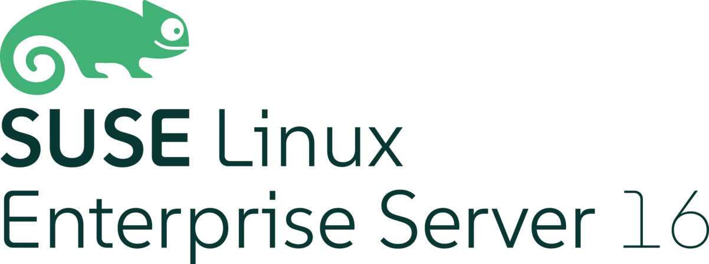

# homelab.kubernerdes.com

Free, as-in beer, software to run infrastructure by SUSE. (*)

(*) StackState (aka SUSE Observability) does require a license key.

<table style="background-color: white;">
<tr>
<td style="background-color: white;">

</td>
</tr>
<tr>
<td style="background-color: white;">

</td>
</tr>
</table>

I am currently (summer 2026) rebuilding my homelab content applying some "lessons learned" from previous attempts.  One thing worth noting, you will see I use a tertiary Domain Name zone - I have several iterations of my homelab (enclave/airgap, community bits, RGS bits, etc..) - and that is why.  For this we will focus on ENVIRONMENT=prime.

**Associated Documentation Site:** The Narrative form guide for this repo is located at https://docs.prime.kubernerdes.com/

What we are working with:
- deploy SUSE Portfolio using Prime Bits 

This repository contains the scripts, configuration files, and documentation for deploying the full SUSE stack on small form-factor hardware (Intel NUCs). It is designed to be run against three distinct deployment environments using a shared codebase, with environment-specific behavior driven entirely by configuration.

> [!TIP] 
> This is not an official SUSE repository. It is a personal lab environment designed to explore and demonstrate the platform using straightforward, repeatable methods.

> [!NOTE] 
> Government/air-gapped-specific content will migrate to a separate repo: https://github.com/jradtke-rgs/carbide-enclave.kubernerdes.com (no longer working on this content)

---

## Goals

- Single codebase that can build out a complete environment end-to-end
- Environment selection via a single config variable — no forking, no duplicating scripts
- Deploy: 
  - Harvester (SUSE Virtualization) 
  - 3 x VMs (SL-Micro)
  - RKE2 
  - Rancher Manager 
  - StackState (SUSE Observability) on RKE2 cluster (deployed via Rancher)
  - NeuVector (SUSE Security) running on an K3s "applications" Cluster (deployed via Rancher)
- Human-readable documentation that explains not just *what* to run, but *why*

---

## Environments

| Environment | Description | Subnet | Domain | Nodes |
|:-----------:|:------------|:------:|:-------|:------|
| **Homelab** | Common infrastructure utilized by any of the other Environments | 10.10.12.0/24 | homelab.kubernerdes.com | nuc-00, nuc-00-01/02/03/04/05/06 |
| **Prime** | SUSE software pulled from the Prime registry over the internet | 10.10.15.0/24 | prime.kubernerdes.com | nuc-01/02/03/04/05/06 |

Other cluster roles (rancher, observability, apps) follow a digit-prefix scheme:   
- rancher = $IP_PREFIX.30    
- observability = $IP_PREFIX.40  
- apps = $IP_PREFIX.50 (K8s endpoints)  
- apps = $IP_PREFIX.51 (Application endpoints)

**Milestones:** Prime MVP

---

## Repository Structure

[TBD] - this will be completed once I have a better idea of how this repo will be organized

---

## IP Assignments

All IPs are derived from `${IP_PREFIX}` defined in `env.sh`.

| Last Octet | Hostname | Purpose |
|:----------:|:---------|:--------|
| .10 | nuc-00 | Admin host (Apache + KVM + libvirt) |
| .30 	| rancher | Rancher Manager cluster VIP |
| .40 | observability | Observability cluster VIP |
| .50 | apps | Applications cluster VIP (administrative) |
| .51 | apps | Applications cluster VIP (user apps) |
| .100 | harvester | Harvester cluster VIP |
| .101 | nuc-X1 | Harvester node 1 | 
| .102 | nuc-X2 | Harvester node 2 |
| .103 | nuc-X3 | Harvester node 3 |
| .104 | nuc-X4 | Harvester node 4 |
| .105 | nuc-X5 | Harvester node 5 |
| .106 | nuc-X6 | Harvester node 6 |

Wildcard DNS: `*.apps.prime.kubernerdes.com` → `${IP_PREFIX}.230`

---

## Day 0 — Design and Plan

**Prerequisites**

- 3 x NUCs (or similar hardware) for Harvester nodes
- 1 x admin workstation (I use a fourth NUC as `nuc-00`)
- Internet connectivity (Community and Prime) or pre-synced Hauler store (Enclave)
- [Hardware Overview](./Hardware.md)

For Prime and Enclave: SUSE Prime portal access — request a license from your SUSE Account Team.

---

## Day 1 — Build

1. Build the **Admin Host** (`nuc-00`)
2. Sync using Hauler
3. Promote content to Harbor
4. ...

---

## Day 2 — Operate

---

## Reference

- [Harvester Releases](https://github.com/harvester/harvester/releases)
- [Rancher Manager — Helm CLI Quick Start](https://ranchermanager.docs.rancher.com/getting-started/quick-start-guides/deploy-rancher-manager/helm-cli)
- [Hauler Documentation](https://docs.hauler.dev/docs/intro)
- [HashiCorp Vault PKI Secrets Engine](https://developer.hashicorp.com/vault/docs/secrets/pki)
- [cert-manager Vault Issuer](https://cert-manager.io/docs/configuration/vault/)

## Questions

Need to decide on:
* IdM
* Certificate Management (CA)
* IaC tooling (probably opentofu? Ansible, if necessary or provides significant value)

## Considerations
* while we are using the 6 x NUCs, need to consider the following
  * 3 x gen10 NUCs will the control-plane (also run Rancher Manager VMs)
  * 3 x gen13 NUCs will be worker nodes
  * VMs will utilize the 1 GBe onboard NIC, Storage Network will use the secondary USB NIC (2.5 GBe)

